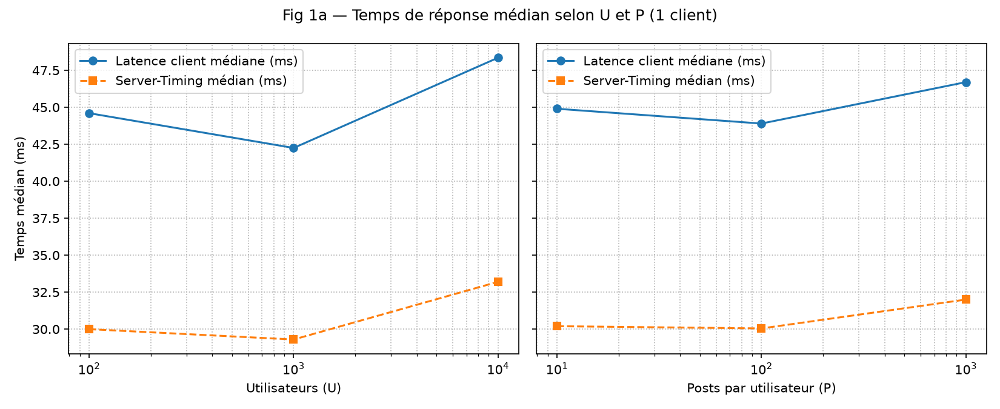
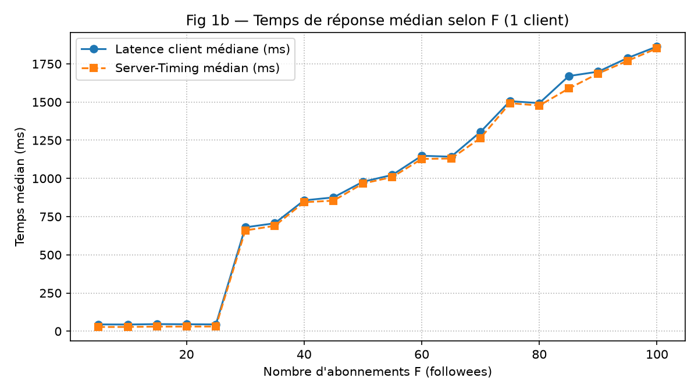
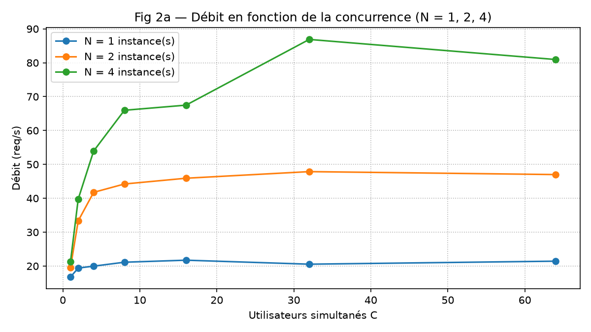
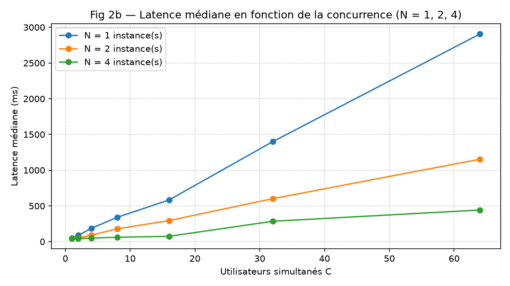
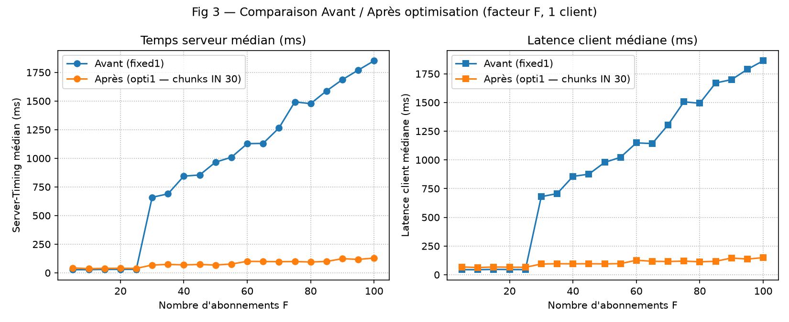

<div align="center">

# RAPPORT PROJET DONNÉES MASSIVES ET CLOUD
### TinyInsta 
### 2026 / 2027

<br>

**Encadrant :** Pascal MOLLI

<br>


<br><br>

**Réalisé par :** Mame Boury CISSE  
*M1 Informatique - ATAL*

</div>

---

## 1. Montage
* **Projet GCP :** `tinyinsta-2026-515115`
* **Région :** `europe-west` (`europe-west1`)
* **Versions déployées :** `default`, `fixed1`, `fixed2`, `fixed4` *(et `opti` pour la Partie 3)*
* **Dates des mesures :** Novembre 2026
* **Machine cliente :** Google Cloud Shell (session `tmux`)
* **Génération des figures :** Orchestrée en une commande via `snakemake --cores 1` (`Snakefile` + `bench/analyze.py`)

### Commandes de peuplement et de mesure exécutées

#### Peuplement de la base (option `--rest` et `--threads 2` pour éviter la saturation gRPC)
```bash
export P="tinyinsta-2026-515115"
gcloud config set project $P

python bench/seed_exact.py --project $P --prefix base   --users 1000  --posts-per-user 20 --followees 20 --threads 2 --rest
python bench/seed_exact.py --project $P --prefix u100   --users 100   --posts-per-user 20 --followees 20 --threads 2 --rest
python bench/seed_exact.py --project $P --prefix u10000 --users 10000 --posts-per-user 20 --followees 20 --threads 2 --rest

for p in 10 100 1000; do
  python bench/seed_exact.py --project $P --prefix p$p --users 100 --posts-per-user $p --followees 20 --threads 2 --rest
done

for f in $(seq 5 5 100); do
  python bench/seed_exact.py --project $P --prefix $(printf 'f%02d' $f) --users 120 --posts-per-user 20 --followees $f --threads 2 --rest
done
```

#### Mesures Partie 1 (`fixed1`, 1 client, 30s par run)
```bash
./deploy_fixed.sh 1
URL=$(gcloud app versions describe fixed1 --service default --format='value(versionUrl)')

# Facteur U (100, 1000, 10000)
for pair in "u100 100" "base 1000" "u10000 10000"; do
  set -- $pair
  TINY_PREFIX=$1 TINY_USERS=$2 TINY_LOG="raw/p1_${1/base/u1000}.csv" \
    locust -f bench/locustfile.py --headless -u 1 -r 1 -t 30s --only-summary --host $URL
done

# Facteur P (10, 100, 1000)
for p in 10 100 1000; do
  TINY_PREFIX=p$p TINY_USERS=100 TINY_LOG="raw/p1_p${p}.csv" \
    locust -f bench/locustfile.py --headless -u 1 -r 1 -t 30s --only-summary --host $URL
done

# Facteur F (5 à 100 par pas de 5)
for f in $(seq 5 5 100); do
  pref=$(printf 'f%02d' $f)
  TINY_PREFIX=$pref TINY_USERS=120 TINY_LOG="raw/p1_${pref}.csv" \
    locust -f bench/locustfile.py --headless -u 1 -r 1 -t 30s --only-summary --host $URL
done

gcloud app versions stop fixed1 --quiet
```

#### Mesures Partie 2 (`fixed1`, `fixed2`, `fixed4`, $C \in \{1, 2, 4, 8, 16, 32, 64\}$, 45s par run)
```bash
for n in 1 2 4; do
  ./deploy_fixed.sh $n
  URL=$(gcloud app versions describe fixed$n --service default --format='value(versionUrl)')
  for c in 1 2 4 8 16 32 64; do
    TINY_PREFIX=base TINY_USERS=1000 TINY_LOG="raw/p2_n${n}_c${c}.csv" \
      locust -f bench/locustfile.py --headless -u $c -r $c -t 45s --only-summary --host $URL
  done
  gcloud app versions stop fixed$n --quiet
done
```

---

## 2. Résultats des parties 1 à 3

### Partie 1 : Coût d'une requête
#### Question : de quoi dépend le temps de traitement d’une timeline ?
* **Hypothèse :** 
  L'analyse de `get_timeline(user, limit=20)` dans `main.py` montre une exécution en deux phases : une lecture directe de l'entité `User` par clé (`client.get(follow_key)`) pour récupérer la liste des $F$ abonnements (soit $F+1$ auteurs avec l'utilisateur lui-même), suivie d'une requête Datastore sur `Post` filtrée par `author IN follows` et triée par `-created` (`limit=20`).
  * **Facteur $U$ :** Temps serveur constant ($O(1)$) — l'index composite `(author, created DESC)` évite tout balayage complet des utilisateurs.
  * **Facteur $P$ :** Temps serveur constant ($O(1)$) — la clause `limit=20` borne le nombre de posts récupérés quel que soit le stock par auteur.
  * **Facteur $F$ :** Temps serveur constant jusqu'à $F = 29$ (soit $\le 30$ auteurs dans la clause `IN`), puis rupture nette et croissance linéaire ($O(F)$) à partir de $F = 30$ : l'opérateur `IN` de Datastore étant limité à 30 valeurs, le code bascule dans le bloc `except` qui exécute séquentiellement $F+1$ requêtes individuelles (`for author in follows: ... fetch(limit=20)`).

* **Figures :**
  
  

* **Réponses aux questions :**
  * **Validation des hypothèses :** **Confirmées à 100 %.** Sur la Fig. 1a, le temps serveur médian reste quasi constant autour de **29,3–33,2 ms** lorsque $U$ passe de 100 à 10 000 ($\times 100$) et autour de **30,05–32,0 ms** lorsque $P$ passe de 10 à 1 000 ($\times 100$). Sur la Fig. 1b, le temps serveur reste stable à **27,5–30,8 ms** pour $F \in [5, 25]$, puis bondit brutalement à **659,65 ms** à $F = 30$ ($\times 21$) et croît linéairement jusqu'à **1 851,5 ms** à $F = 100$ ($\approx 18,5\text{ ms}$ par auteur supplémentaire).
  * **Part de la latence client due au réseau :** La latence réseau ($\text{LATENCY\_MS} - \text{SERVER\_MS}$) représente un surcoût fixe d'environ **13 à 21 ms** par aller-retour entre Cloud Shell et App Engine : cela correspond à **~31–35 %** de la latence totale lorsque le traitement est rapide ($U$, $P$, et $F \le 25$), mais devient négligeable (**< 2 %**) dès que $F \ge 30$ où le temps serveur domine largement.
  * **Entités Datastore lues et coût pour 1 million de timelines :**
    *(Grille tarifaire Datastore : 0,036 $ / 100 000 lectures d'entités, soit 0,36 $ par million d'entités lues).*
    * **Selon $U$ et $P$ (avec $F = 20 \le 29$) :** 1 requête `IN` lit **1** entité `User` + **20** entités `Post` = **21 entités** par timeline $\rightarrow$ **21 millions d'entités** pour 1M de timelines, soit **7,56 $**.
    * **Selon $F$ :**
      * Pour $F \le 25$ (ex. $F = 20$) : **21 entités** $\rightarrow$ **7,56 $** / 1M timelines.
      * Pour $F \ge 30$ (ex. $F = 100$, avec $P = 20$) : le repli exécute $F + 1$ requêtes de 20 posts chacune, lisant $1 + 20 \times (F + 1)$ entités. À $F = 30$ : **621 entités** (**223,56 $** / 1M timelines). À $F = 100$ : **2 021 entités** (**727,56 $** / 1M timelines, soit près de **100 fois plus cher** qu'à $F = 20$).

---

### Partie 2 : Capacité
#### Question : combien de timelines par seconde une instance peut-elle servir ? Le débit maximal est-il proportionnel au nombre d’instances ?
* **Hypothèse :**
  * **Saturation d'une instance ($N=1$) :** En consultant `app-fixed-1.yaml` / `app.yaml` (instance standard F1 mono-cœur avec Gunicorn à workers limités), une instance traite un nombre restreint de requêtes simultanées en parallèle. Le débit devrait augmenter avec $C$ jusqu'à saturer le CPU / les workers de l'instance autour de $C = 2$ à $4$, atteignant un plateau $D_{\max}(1)$.
  * **Loi de Little :** Au-delà de la saturation, le débit $D$ plafonne à $D_{\max}$ tandis que les $C$ utilisateurs en boucle fermée s'accumulent en file d'attente : la latence médiane doit croître linéairement selon $\text{Latence} \approx C / D_{\max}$.
  * **Passage à l'échelle horizontal ($N = 1, 2, 4$) :** `/api/timeline` étant sans état (*stateless*) et en lecture seule sur le jeu `base`, multiplier le nombre d'instances par $k$ devrait multiplier le débit maximal par environ $k$ ($D_{\max}(4) \approx 4 \times D_{\max}(1)$).

* **Figures :**
  
  

* **Réponses aux questions :**
  * **Point de saturation et capacité d'une instance :**
    * **$N = 1$ :** Saturation atteinte dès **$C = 2$ à $4$**, avec une capacité maximale d'environ **21,7 req/s** (plateau stable entre 19,4 et 21,7 req/s pour $C \ge 2$). Cette limite s'explique par l'exécution synchrone sur un seul vCPU (instance F1) où chaque requête bloque son thread/worker pendant ~30 ms d'I/O réseau vers Datastore et de sérialisation JSON.
    * **$N = 2$ :** Saturation atteinte autour de **$C = 4$ à $8$**, plafonnant à **47,9 req/s** (à $C = 32$).
    * **$N = 4$ :** Saturation atteinte autour de **$C = 8$ à $16$**, culminant à **86,9 req/s** (à $C = 32$, puis léger tassement à 81,0 req/s à $C = 64$ dû à la contention).
  * **Vérification de la loi de Little :** **Oui, elle est très bien vérifiée au-delà de la saturation**, notamment pour $N=1$ et $N=2$ :
    * Pour $N = 1$ et $C = 64$ ($D = 21,44\text{ req/s}$), la loi de Little prédit $64 / 21,44 = 2\,985\text{ ms}$, ce qui correspond quasi exactement à la latence médiane mesurée de **2 906,6 ms** (écart < 3 %).
    * Pour $N = 2$ et $C = 64$ ($D = 47,00\text{ req/s}$), elle prédit $64 / 47,00 = 1\,362\text{ ms}$ contre **1 153,4 ms** mesurés.
    * Pour $N = 4$ et $C = 64$ ($D = 80,96\text{ req/s}$), elle prédit $791\text{ ms}$ contre **442,6 ms** mesurés (la dispersion entre les 4 files d'attente explique un léger écart entre médiane et moyenne).
  * **Proportionnalité du débit ($N=1 \rightarrow N=4$) :** **Oui, le passage à l'échelle horizontal est quasi linéaire** :
    * $D_{\max}(1) = 21,73\text{ req/s}$
    * $D_{\max}(2) = 47,87\text{ req/s}$ (facteur **$\times 2,20$**)
    * $D_{\max}(4) = 86,89\text{ req/s}$ (facteur **$\times 4,00$**)
    * Le débit maximal est donc bien multiplié par **4,0** en passant de 1 à 4 instances : l'architecture *stateless* et le répartiteur de charge d'App Engine distribuent efficacement la charge sans goulot central sur le jeu `base`.

---

### Partie 3 : Corriger et re-mesurer
* **Goulot identifié et correction :** *(À compléter après exécution de la Partie 3 — ex. : découpage de la liste `follows` en paquets de 30 auteurs (`chunks` de 30) pour continuer à utiliser l'opérateur `IN` de Datastore lorsque $F \ge 30$, ou mise en cache mémoire/Memcache des timelines).*
* **Figure :**
  
* **Interprétation et coût de la correction :** *(À compléter après mesure de la version `opti` : gain de latence/débit et coût en complexité, mémoire ou cohérence des données).*

---

## 3. Tableau des verdicts

| Dimension | Passe à l'échelle ? | Jusqu'où ? | Pourquoi (mécanisme) | Preuve |
| :--- | :--- | :--- | :--- | :--- |
| **Utilisateurs ($U$)** | **Oui** | Au moins $U = 10\,000$ (testé sur $\times 100$) | Accès direct par clé sur `User` ($O(1)$) et requête sur index composite `Post(author, created DESC)` sans scan global de la table `User`. | Fig. 1a |
| **Posts par utilisateur ($P$)** | **Oui** | Au moins $P = 1\,000$ (testé sur $\times 100$) | L'index composite pré-trie les posts par date décroissante et `limit=20` stoppe la lecture après 20 entités, quel que soit $P$. | Fig. 1a |
| **Followees ($F$)** | **Non (rupture à seuil)** | Jusqu'à **$F = 29$** ($\le 30$ auteurs avec soi-même) | Au-delà de 30 éléments, la clause `IN` de Datastore lève une exception et le code bascule sur une boucle séquentielle de $F+1$ requêtes individuelles ($O(F)$). | Fig. 1b |
| **Instances ($N$)** | **Oui** | Au moins $N = 4$ instances (~87 req/s) | API *stateless* en lecture seule : le load balancer App Engine répartit équitablement le trafic, multipliant le débit maximal par $\approx N$. | Fig. 2a / 2b |

---

## 4. Validité

1. **Instances actives :**
   La colonne `unique_instances` (calculée via l'en-tête `X-Instance`) confirme que **100 % des mesures de la Partie 1** ont été servies par **1 seule instance**, et que les séries de la Partie 2 ont bien mobilisé exactement **1, 2 et 4 instances distinctes** selon la version déployée (`fixed1`, `fixed2`, `fixed4`), sans interférence de l'autoscaling.
2. **Indépendance des runs :**
   Les runs sont indépendants : `/api/timeline` n'effectue aucune écriture en base (les jeux de données `base`, `u*`, `p*`, `f*` sont strictement en lecture seule pendant les benchmarks), chaque jeu est isolé par son préfixe de clés, et chaque version `fixedN` est démarrée puis arrêtée à la fin de sa série. Seule la toute première requête après déploiement subit un léger *cold start*, absorbé sur la durée du run (30s à 45s).
3. **Part réseau de la latence :**
   En comparant `LATENCY_MS` (côté Locust dans Cloud Shell) et `SERVER_MS` (`Server-Timing` côté App Engine), le temps réseau aller-retour est quasi constant autour de **13 à 21 ms**. Il représente **~31 à 35 %** de la latence lorsque le traitement serveur est rapide (~30 ms pour $U$, $P$ et $F \le 25$), et tombe à **< 2 %** dès que $F \ge 30$ (où `SERVER_MS` atteint 660 à 1 852 ms).
4. **Échecs et codes HTTP observés :**
   Un échec est défini par tout statut différent de `HTTP 200` (codes `5xx` ou `0` pour timeout réseau).
   * **Partie 1 :** **0 % d'erreur** sur les 7 015 requêtes (100 % de `HTTP 200`).
   * **Partie 2 :** **0 % d'erreur** à faible charge ($C \le 8$, hors 1 requête sur 2 414 à $N=4, C=4$). À forte congestion ($C \in \{16, 32, 64\}$), un très faible taux d'erreur apparaît (**0,78 % à 1,01 %** sur `fixed1`, **0,28 % à 0,39 %** sur `fixed2`, **0,18 % à 0,40 %** sur `fixed4`), correspondant à des rejets ponctuels de file d'attente App Engine sous saturation.
5. **Chemin de code exercé :**
   Le basculement brutal de la latence serveur entre $F = 25$ (30,8 ms) et $F = 30$ (659,65 ms) sur la Fig. 1b démontre expérimentalement que le chemin principal (`query.add_filter('author', 'IN', follows)`) est bien exercé pour $F \le 29$, et que le chemin de repli (`except` avec boucle séquentielle sur chaque auteur) est déclenché exactement à partir de $F = 30$. De même, `TINY_PREFIX` et `TINY_USERS` garantissent que chaque utilisateur Locust interroge un utilisateur distinct du préfixe ciblé.
6. **Estimation du coût de la campagne :**
   Voir le détail chiffré dans la section 5 ci-dessous (coût total largement inférieur au plafond de 5 $ estimé par le sujet).

---

## 5. Coût de la campagne
* **Écritures Datastore (peuplement des jeux) :** ~414 300 entités créées au total (`base` : 21 000, `u100` : 2 100, `u10000` : 210 000, `p10/100/1000` : 111 300, `f05..f100` : 50 400 + purges/re-seeds éventuels) $\rightarrow$ **< 0,50 $** (tarif : 0,108 $ / 100 000 écritures).
* **Lectures Datastore (Parties 1 et 2) :**
  * **Partie 1 :** 7 015 requêtes réussies, dont 6 613 avec $F \le 25$ ($\times 21$ entités = 138 873 lectures) et 402 avec $F \ge 30$ ($\approx 439\,352$ lectures) $\rightarrow$ **~578 225 lectures**.
  * **Partie 2 :** 37 254 requêtes réussies sur `base` ($F=20$, $\times 21$ entités) $\rightarrow$ **~782 334 lectures**.
  * **Total lectures (Parties 1 + 2) :** **~1,36 million de lectures** $\rightarrow$ **~0,49 $** (tarif : 0,036 $ / 100 000 lectures).
* **Heures d'instances App Engine (`fixed1`, `fixed2`, `fixed4`) :** Environ 30 minutes cumulées d'instances F1/B1 actives (arrêtées immédiatement après chaque bloc via `gcloud app versions stop`), couvertes par le quota gratuit quotidien App Engine (28 heures-instances/jour) $\rightarrow$ **0,00 $** (ou **< 0,10 $** hors quota).
* **Coût total facturé (Parties 1 et 2) :** **~1,00 $** *(à compléter avec le relevé exact de la console GCP Facturation après la Partie 3)*.